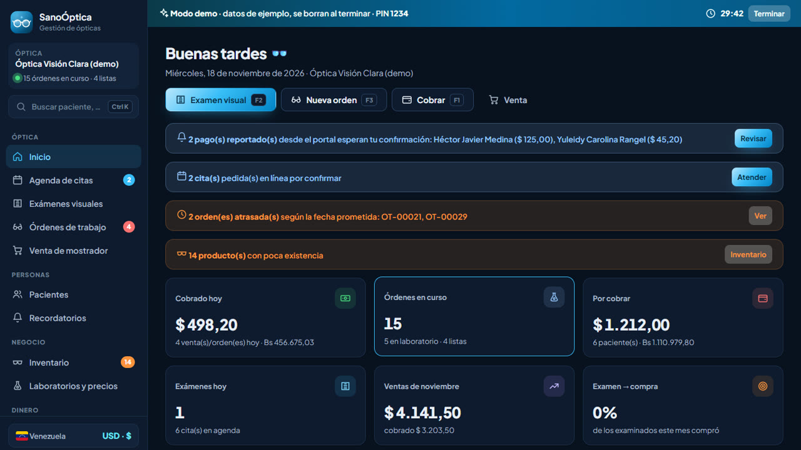

# SanoÓptica 👓

Software de gestión para ópticas y consultorios de optometría, de la línea **Sano** (SanoGym, SanoDental, SanoDoctor, SanoTecnico, SanoGestion, SanoCortes, SanoFarmacia, SanoLicores, SanoCondominio, SanoAcademia). Examen visual con fórmula OD/OI, órdenes de trabajo con el laboratorio, abonos y saldos, inventario de monturas, venta de mostrador, agenda en línea y portal del paciente. Funciona en la computadora, la tablet y el teléfono (PWA instalable, también sin internet).

**Producción:** https://sano-optica.web.app · **Credenciales:** `CREDENCIALES_SANO_OPTICA.txt` (no se sube a git)



## Funciones

| Módulo | Qué hace |
| --- | --- |
| Inicio | Accesos rápidos (examen F2, orden F3, cobrar F1, venta F4), cobrado hoy, órdenes en curso, por cobrar, conversión de examen a compra, embudo de órdenes, citas de hoy, listos para retirar y alertas (pagos reportados, citas pedidas, atrasos, poca existencia). |
| Examen visual | Agudeza visual sin y con corrección, refracción OD/OI (esfera, cilindro, eje, adición, prisma, DP y altura) con **validación de rangos**, **transposición del cilindro**, presión intraocular, queratometría, lentes de contacto, **diagnóstico y cristal sugeridos** según graduación y edad, próximo control. La fórmula se imprime con **QR verificable**. |
| Órdenes de trabajo | Armador en 5 pasos: fórmula, montura del inventario o propia, cristales y tratamientos de tu lista de precios, extras, laboratorio y fecha prometida. Abono mínimo configurable, descuento en $ o %. Tablero **registrada → laboratorio → control de calidad → lista → entregada**, con atrasos marcados, **lista de control de calidad**, no deja entregar con saldo, **garantía** con historial, orden para el laboratorio con cilindro negativo y sin precios. |
| Venta de mostrador | Lentes de sol y de contacto, soluciones y accesorios con lector de código de barras, carrito y vuelto. |
| Pacientes | Historia con todas sus fórmulas y su evolución, órdenes, pagos, estado de cuenta, control anual, alertas de salud, importar y exportar CSV. |
| Portal del paciente | `/paciente/CÓDIGO` sin contraseña: **estado de sus lentes paso a paso**, su fórmula, saldo con las cuentas para pagar, **reportar pago** y pedir cita. |
| Agenda en línea | `/cita/CÓDIGO` con QR: motivo, día y hora libre según tu horario; la cita llega para confirmar y crea el paciente. |
| Cobranza y caja | Pagos en $ o Bs a la tasa BCV del día, pagos reportados por confirmar, saldos con recordatorio por WhatsApp, cierre de caja con conteo de efectivo (cuadra, falta o sobra). |
| Inventario y laboratorios | Monturas por marca, modelo, color, material y medidas, con costo, margen, existencia mínima, entradas y salidas y etiquetas. Laboratorios con días prometidos vs. **días reales**; lista de precios de cristales y tratamientos. |
| Recordatorios | Controles vencidos, lentes sin retirar, saldos, citas de mañana y cumpleaños, con mensaje listo para WhatsApp. |
| Gastos y reportes | Gastos por categoría; reportes con PIN: vendido, cobrado, ganancia bruta, ticket promedio, tipo de cristal, marcas, tratamientos, diagnósticos, laboratorios y vendedor. |
| Demo | 30 minutos sin registro con una óptica de ejemplo (48 pacientes, 40+ fórmulas, 30 órdenes en todos los estados, 28 productos, 3 laboratorios, PIN 1234) y recorrido guiado; todo se borra al terminar. |

## Estructura

- `public/` — la app (JavaScript sin compilación + Firebase 10.14.1). `js/views/` una pantalla por archivo; `js/optica.js` fórmulas, diagnósticos, cristales, estados y cálculos; `js/ops.js` operaciones (exámenes, órdenes, pagos, inventario, citas, caja, publicar portales); `js/order.js` armador y ficha de la orden; `js/rx.js` examen visual.
- `firestore.rules` — cada óptica solo ve lo suyo (`tenants/{uid}`); `portals`, `rx` y `bookings` se leen solo por código exacto; `inbox` valida cada pago reportado o cita pedida desde las páginas públicas.
- `scripts/` — aprovisionamiento, pruebas y video tutorial.

## Comandos (desde `scripts/`)

```sh
# Emuladores (en la carpeta del proyecto)
firebase emulators:start --only auth,firestore,hosting --project sano-optica   # app en http://127.0.0.1:5191/?emu=1

sh test-emu.sh                 # crea las cuentas en el emulador y corre la prueba E2E (63 verificaciones)
node mobile-check.mjs          # 6 tamaños de pantalla (320 px a portátil) + portal, fórmula y agenda, sin desbordes
node smoke.mjs                 # recorrido rápido de todas las pantallas y páginas públicas
node prod-smoke.mjs            # prueba rápida en producción (la demo se limpia sola)
node pwa-check.mjs             # instalable en PC y Android

node provision.mjs 20          # crea/actualiza las cuentas en producción
node icons.mjs                 # regenera íconos y logos desde public/assets/logo.svg
node tutorial/make-video.mjs   # graba el video tutorial narrado (voz es-VE)
firebase deploy --only firestore,hosting --project sano-optica
```
